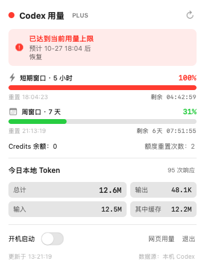

# CodexUsage — macOS 菜单栏 Codex 用量控件

一个纯 Swift / AppKit 编写的菜单栏小程序（无 Dock 图标、无第三方依赖），点击菜单栏图标即可查看本机 OpenAI Codex 的实时用量与今日 token 消耗。



## 功能

- **短期窗口（5 小时）**：已用百分比、进度条、重置时刻与剩余倒计时
- **周窗口（7 天）**：同上，倒计时按“天 + 时分秒”显示
- **达限提醒**：达到当前窗口上限时，面板顶部显示红色横幅与预计恢复时间
- **Credits 余额**与**额度重置次数**
- **今日本地 Token 统计**：总计 / 输入 / 其中缓存 / 输出，以及响应次数
- **开机启动**开关（基于系统 `SMAppService` 登录项）
- 菜单提供“网页用量”快捷入口与“退出”
- 在线数据每 60 秒、本地 token 每 120 秒自动刷新，倒计时每秒更新，也可点右上角按钮手动刷新

## 系统要求

- macOS 15.0 及以上（Apple Silicon / Intel 均可）
- 本机已安装并登录 Codex 桌面端（OAuth 登录态）

## 安装与运行

直接运行构建产物：

```bash
open build/CodexUsage.app
```

安装到 `/Applications`（安装前请先从菜单栏控件中退出正在运行的实例）：

```bash
./build.sh install
```

从源码重新构建：

```bash
./build.sh
```

产物为 ad-hoc 签名的 `.app`（bundle id `com.local.codex-usage`，`LSUIElement` 后台应用，不显示 Dock 图标）。首次打开若被 Gatekeeper 拦截，可在“系统设置 → 隐私与安全性”中允许。

## 数据来源

| 数据 | 来源 | 说明 |
|---|---|---|
| 窗口百分比 / 重置时间 / Credits / 套餐 | `GET https://chatgpt.com/backend-api/wham/usage` | 携带本机 Codex 登录态访问官方接口，仅这一个出站请求 |
| 今日 token | `~/.codex/sessions/**/rollout-*.jsonl(.zst)` | 读取 `token_usage_record` 事件，按 `response_id` 去重后汇总 |

本地统计按**本地时区**判定“今日”，rollout 文件按 UTC 分目录，程序会自动扫描本地今日所跨的 1～2 个 UTC 日期目录，无需全量遍历。

`.jsonl.zst` 解压可选依赖系统 `zstd`（依次查找 `/opt/homebrew/bin/zstd`、`/usr/local/bin/zstd`、`/usr/bin/zstd`）。未安装时自动跳过压缩文件；当天的 rollout 通常为明文 `.jsonl`，不影响今日统计。

## 安全与隐私边界

- 只**读取** `~/.codex/auth.json` 中的 `access_token` 与 `account_id` 用于接口鉴权
- **绝不使用 `refresh_token`，绝不写入或修改 `~/.codex` 下任何文件**，避免触发 token 轮换导致 Codex 桌面端掉登录
- access token 过期（JWT `exp` 判断或接口返回 401/403）时，面板提示重新打开 Codex 桌面端，由其自身完成续期，本程序不代为刷新
- 所有统计在本机完成，除上述官方用量接口外不向任何第三方发送数据

## 卸载

1. 在菜单栏面板中点“退出”
2. 若开启过开机启动，先关闭面板中的“开机启动”开关
3. 删除 `CodexUsage.app` 即可；程序不写任何配置文件

## 实现原理

整体是一个 **LSUIElement 后台应用**：不显示 Dock 图标，只在菜单栏放一个 `NSStatusItem`；点击后通过 `NSPopover` 弹出 `PanelController` 的面板。整个项目只用 Foundation / AppKit / Combine / ServiceManagement，无 SwiftUI、无第三方依赖，纯手写布局约束。

**状态与刷新调度（RefreshStore）**

面板所有数据来自一个 `RefreshStore`（Combine `@Published`），面板用 `@Published` 订阅自动重绘，三层节奏互不阻塞：

- 远程用量接口每 **60 秒**请求一次；
- 本地 token 统计每 **120 秒**扫描一次；
- 重置倒计时由本地日期每秒重算，不依赖网络。

**认证复用（UsageAPI）**

程序不做任何 OAuth，而是直接读取 Codex 桌面端已经写好的 `~/.codex/auth.json`，取出 `tokens.access_token` 与 `account_id`，以 `Authorization: Bearer <token>` 加 `chatgpt-account-id` 请求头发往 `chatgpt.com/backend-api/wham/usage`。token 过期（JWT 的 `exp` 到期或接口 401/403）时面板切到橙色错误态，提示用户重新打开 Codex 桌面端由它自己续期。

**本地 token 统计（TokenUsageScanner）**

Codex 把每次会话存成 `~/.codex/sessions/<UTC 年/月/日>/rollout-*.jsonl`（旧会话压缩为 `.jsonl.zst`）。程序逐行读取 JSONL，只关心 `token_usage_record` 事件，按 `response_id` 去重（一次响应的输入/缓存/输出会分布在多条记录里）后汇总。因为“今天”按**本地时区**划分，而目录按 UTC 划分，程序会计算本地今日 00:00 与 23:59 各属于哪一天的 UTC 目录，最多只扫这 1～2 个目录，避免启动时全量解压几十个压缩文件。

**UI 细节（PanelController）**

- 自定义 `NSView` 子视图负责进度条轨道/填充、状态圆点、窗口标题栏，颜色通过监听 `viewDidChangeEffectiveAppearance` 在深浅色外观切换时重解析，保证系统深色模式下面板自动跟随；
- 自绘的 `IntrinsicLabel` 重写 `intrinsicContentSize`，按字符串真实绘制宽度报告固有尺寸，解决 `NSTextField` 在横向 StackView 里“被留白压没”或“中英混排少算几像素被截断”的布局顽疾；
- `viewDidLayout` 时按 `fittingSize` 更新 `NSPopover.preferredContentSize`，面板高度随内容（错误态 / 达限态 / 正常态）自适应。

**安全设计**

只读取不写入 `~/.codex`，绝不触碰 `refresh_token`（避免触发 token 轮换导致 Codex 桌面端掉线），除官方用量接口外没有任何外发网络请求。

## 源码结构

```
Sources/CodexUsage/
├── main.swift              入口
├── AppDelegate.swift       状态栏项 + NSPopover
├── Models.swift            接口模型 / 路径常量
├── UsageAPI.swift          wham/usage 请求与认证读取
├── TokenUsageScanner.swift 本地 rollout 扫描与 token 汇总
├── RefreshStore.swift      轮询调度与状态管理
├── LaunchItemHelper.swift  登录项开关
└── PanelController.swift   纯 AppKit 面板 UI
```

## 构建兼容性备注

部分机器的 Command Line Tools 残留了重复的 `module.modulemap` / `bridging.modulemap`，会导致 Swift 编译器报 SwiftBridging 重复定义。`build.sh` 会自动探测该情况并生成一个 VFS overlay 遮蔽旧模块映射，无需 sudo、不改动系统目录。
